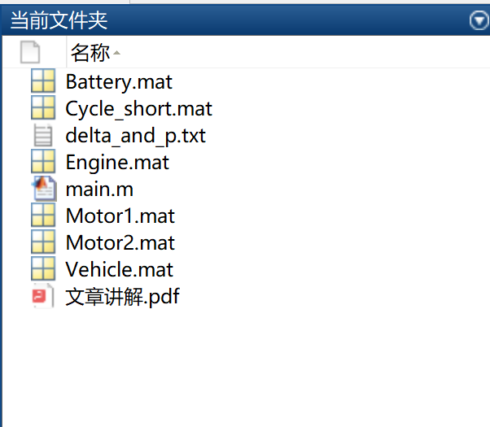

# Best Scheduling of Hybrid Electric Vehicle Based on Minimum Principle (PMP) (Matlab Code + Data + Article Explanation)

Hybrid Electric Vehicle Optimal Scheduling Based on the Principle of Least Utilization (Matlab Code + Data + Article Explanation)

## Images

<!-- PAYMENT_BLOCK -->

## Get this dataset

- Payment link (Stripe): [Buy now](https://buy.stripe.com/3cs8yP7sY87d0vu9AB)
- Payment QR code: 

<!-- /PAYMENT_BLOCK -->
